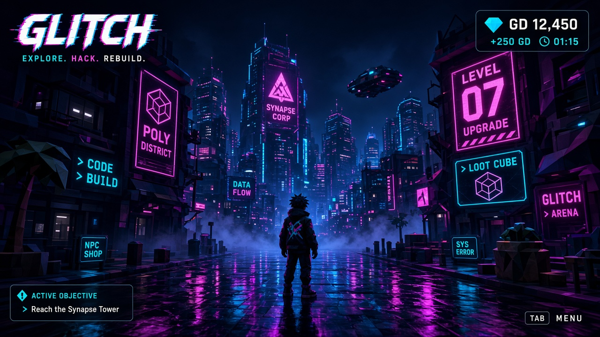
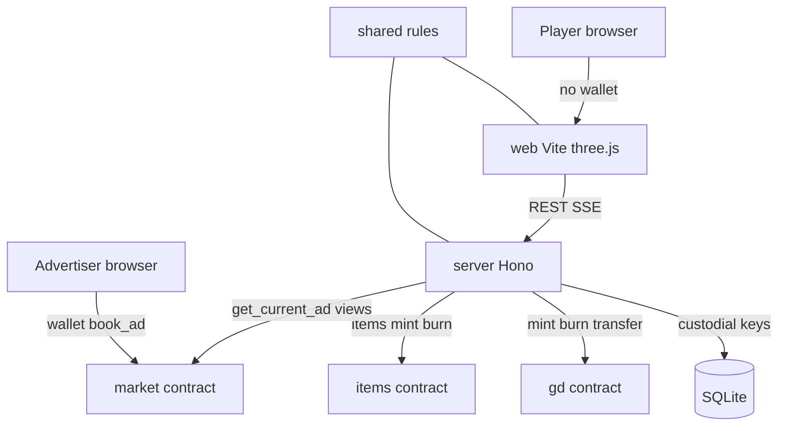

# Glitch

Glitch is a 3D city game on **NEAR testnet** (or a local **mock** ledger). Players earn and spend **GD** (NEP-141) by playing. NPC merchants hold GD. Items live in one **NEP-245-style** multi-token contract. The **server** validates every game result before mint, burn, or transfer. Players never see a wallet, seed phrase, or gas prompt. The only wallet screen is `/advertise` (billboard ads paid in testnet NEAR).

**Track 09 — Games With Real Economies** at [NEAR Hackathon](https://nearhackathon.com/). See [docs/TRACK09.md](docs/TRACK09.md). This repo does **not** use NEAR Intents. Testnet-only work is eligible.



The pre-hackathon prototype is `legacy/glitch-prototype-v2c.html` (reference only). Hackathon work is the TypeScript split, three contracts, and the server-settled loop below.

## Architecture



## Trust model

The server is a **trusted custodian and oracle**. It creates each player as a custodial NEAR subaccount, holds the encrypted key, and signs every mint, burn, and transfer after it validates the game result. In `CHAIN_MODE=mock`, the same APIs write a SQLite ledger instead of RPC. `available = chain − pending burns − escrow` (see [docs/ONCHAIN.md](docs/ONCHAIN.md)).

## Try it (mock — no secrets) — primary screener path

1. `cp server/.env.example server/.env.local` (defaults to `CHAIN_MODE=mock`).
2. `npm install` at the repo root.
3. `npm run dev` (API `http://localhost:8787`, Vite `http://localhost:5173`).
4. Open `http://localhost:5173`. Use **Sign in**, **Create account**, or **Play as guest**.
5. Assist → Settings should show **Mock chain (no testnet)**.

### Verify (automated)

```text
npm install
npm test
npm run verify
```

`npm run verify` boots mock mode in-process and prints PASS/FAIL for: **signup**, **vault**, **purchase**, **forge**, **GET /ads**. Full checklist: [docs/TEST.md](docs/TEST.md).

## What you can do (UI)

| Surface | How | What |
| --- | --- | --- |
| Intro | First screen | Tabs: Sign in, Create account, Play as guest. Google only if `GOOGLE_CLIENT_ID` is set |
| City | WASD / stick; hold-drag look | Exchange (trade), Vault Lab, Attention Tower (post), Gear Forge, Neon Diner, Home |
| Assist | Click floating drone or **P** | Modules: Social, Chat, Map, Balance (+ city-day sim), Profile, Pose, Settings, My Home, Market |
| HUD tabs | Top-right | Feed, Skills, Rank (`GET /leaderboard`), About |
| Advertise | `/advertise` | Wallet books ad slots in NEAR |
| Admin | `/admin` | Ops health if `ADMIN_TOKEN` is set |

Detail: [docs/PLAYER_UI.md](docs/PLAYER_UI.md).

## Try it (NEAR testnet) — optional

Needs a funded `players` parent account. Keys stay in `server/.env.local` (never commit). Map: [docs/ACCOUNTS.md](docs/ACCOUNTS.md).

1. Set `CHAIN_MODE=testnet` and fill `GD_CONTRACT`, `ITEMS_CONTRACT`, `MARKET_CONTRACT`, `ROOT_ACCOUNT`, `TREASURY_KEY`, `KEY_ENCRYPTION_SECRET`.
2. `npm install` && `npm run dev`.
3. Create or sign in. Expect `<name>.players.…` and ~60,000 GD `available` on `GET /me`.
4. Diner / vault / forge / advertise as in the walkthrough in older releases; settlement map: [docs/ONCHAIN.md](docs/ONCHAIN.md).

`npm run near:smoke -w @glitch/server` hits the live chain. `items:seed` and `merchants:setup` are idempotent setup scripts.

## What is on chain

| Movement | Settlement |
| --- | --- |
| New player 60,000 GD | Treasury `gd.mint` once |
| Vault / trade profit / post profit | Treasury `gd.mint` after server accepts result |
| Trade losses, fees, half post cost | Accrue in SQLite; flush later with `burn_from` |
| Food, furniture, studio, maintenance | Player `ft_transfer` to merchant; then hunger or `items.mint` (pay-then-deliver) |
| Gear | GD to smith, burn shards, `create_token` + `mint` for `gear-<type>-<uuid>` |
| Player market sale | Buyer pays seller; item `admin_transfer`; 2% fee pending burn |
| Ads | Advertiser `market.book_ad` (NEAR → treasury); city reads `get_current_ad` |

## Contracts (NEAR testnet)

| Account | Role |
| --- | --- |
| `gd.glitch-edoye.testnet` | GD NEP-141 |
| `items.glitch-edoye.testnet` | Items NEP-245 subset |
| `market.glitch-edoye.testnet` | Ad slots (NEAR) |
| `players.glitch-edoye.testnet` | Server signer; parent of player accounts |
| `<name>.players.glitch-edoye.testnet` | Custodial player |
| `chef` / `smith` / `dealer` under the chain root | NPC merchants holding GD |

Confirm live ids in `server/.env.local` when `CHAIN_MODE=testnet`.

## Server routes (live)

Session cookie required unless noted.

| Method | Path | Notes |
| --- | --- | --- |
| GET | `/health` | Public |
| POST | `/auth/login` | Name / PIN / guest / signup |
| GET | `/auth/google/config` | Public; `{ clientId }` or null |
| POST | `/auth/google` | Google ID token → custodial account |
| GET | `/me` | `available`, profile |
| GET | `/me/chain` | On-chain / mock proof |
| GET | `/leaderboard` | Top-20 by spendable GD (15s cache) |
| GET | `/stream` | SSE world tick |
| POST | `/trade/open`, GET `/trade` | Bets |
| POST | `/vault/start`, `/finish`, `/cancel` | Vault Cracker |
| POST | `/post` | Attention booth |
| POST | `/shop/buy` | Food / furniture catalog |
| POST | `/home/buy`, `/home/pay-rent` | Studio |
| POST | `/rest` | Bench / sleep |
| POST | `/forge/mint` | Gear |
| GET/POST | `/market`, `/market/list`, `/market/buy`, `/market/cancel` | Player listings |
| GET | `/merchants` | Dynamic quotes |
| POST | `/sim/fast-forward` | Deterministic city day (no chain write) |
| GET | `/ads`, `/ads/creative` | Public billboards |
| GET | `/admin/health` | `x-admin-token`; 404 if unset |

## Client-only balance gaps

These change the **displayed** balance in the browser and are **not** the server purchase path:

1. Fast travel (Map → Go)
2. Passive holding tax
3. CIA fines

## Known limitations

- No NEAR Intents, no NEAR Auth, no mainnet.
- Merchant NPCs are rule-driven accounts with GD, not LLM agents.
- Google sign-in appears only when `GOOGLE_CLIENT_ID` is set.
- Floating assist companion, poses, home paint, and level hints are **client cosmetic** (localStorage); not minted.
- Chef does not auto-close on low float; market contract prize-cycle methods are unused by the server.
- Fast travel, holding tax, and CIA fines are still client-side (see above).

## Layout

- `web/` — Vite + three.js. No player wallet. `advertise.html` uses wallet selector.
- `server/` — Hono, SQLite, NEAR or mock ledger.
- `shared/` — economy, merchants, events, RNG (mulberry32).
- `contracts/` — `gd`, `items`, `market` (deployed; do not rename methods).
- `docs/` — [PLAYER_UI.md](docs/PLAYER_UI.md), [TEST.md](docs/TEST.md), [TRACK09.md](docs/TRACK09.md), [ONCHAIN.md](docs/ONCHAIN.md), [ECONOMY.md](docs/ECONOMY.md), [ITEMS.md](docs/ITEMS.md), [ACCOUNTS.md](docs/ACCOUNTS.md).

## Track 09 in one line

Economy **is** the gameplay: earn GD in minigames, spend at merchants with wallets, list items to other players, forge unique gear — and the player never opens a chain wallet. Intents are out of scope; NEP-245 items and custodial play are in. Details: [docs/TRACK09.md](docs/TRACK09.md).
